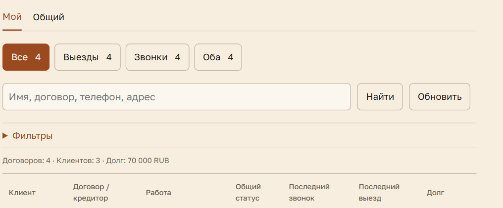
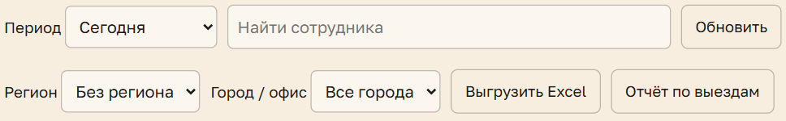

# Руководство по работе в CRM СНГ
Редакция после большого обновления. Начните с двух первых глав: они объясняют, что изменилось и как восстановить работу без потери черновиков и очереди. Остальные главы описывают задачи по ролям.

## Что изменилось после большого обновления
### Если раньше вы пользовались Хардом и Софтом
- Теперь для звонков и выездов нужна одна программа «Взыскание СНГ» 3.4.0. Не устанавливайте отдельный Софт поверх неё. Прежние ярлыки обновляются на единый клиент; звонки и выезды открываются в одном портфеле. Сервер определяет, какой вид работы доступен именно вам.
- Вход, черновики и неотправленные операции должны сохраниться. Старые папки профилей не удаляются при обновлении или удалении программы. Если раньше были установлены оба приложения, сначала проверьте «Отправки» в новом клиенте и не вводите результаты повторно.
- На телефоне используется тот же рабочий логин. Адрес прежний: https://hard.rimborso.ru. Оболочка обновляется автоматически; очищать данные браузера или искать отдельную кнопку обновления не нужно.
### Где теперь искать привычные действия
- Звонок: «Портфель → Мой → Звонки» на телефоне либо «Портфель → Звонки» в Windows. Откройте клиента и нажмите «Звонок».
- Выезд: «Портфель → Мой → Выезды → Записать выезд» на телефоне либо действие «Выезд» в карточке. Заранее скачанные для офлайна карточки находятся в «Маршруте».
- Общий поиск: «Все клиенты» в Windows и «Общий» на телефоне. «Мой» показывает только назначенные вам работы.
- Проверка сохранения: «История» подтверждает запись в карточке, «Отправки» показывает локальную очередь и серверные квитанции. Это разные проверки: при слабой связи сначала смотрите «Отправки».
- Связь, пароль и диагностика: «Подключение». На телефоне раздел может быть внутри «Ещё».
- Результаты команды: «Команда → Результаты». Готовые «Дневной Excel» и «Трёхчасовой Excel» также находятся в «Показателях» руководителя.
- Курьерская передача: «Передачи → Результат доставки». Пул для логиста — «Курьерские пулы» в Windows.
### Что важно знать о новых ограничениях
Мобильный вход действует 48 часов от входа и не продлевается простой активностью. После этого снова войдите под тем же сотрудником с включённой сетью: локальные карточки, черновики и очередь сохранятся.
Полный установщик Windows занимает около 299 МиБ. При слабой связи скачивание может занять много времени; не запускайте параллельно несколько копий и не очищайте профиль из-за долгой загрузки.

## Как себе помочь
### Программа выкинула на вход
1. Не очищайте данные браузера, не удаляйте профиль Windows и не создавайте результаты заново. Проверьте сеть и войдите под тем же логином, который использовался для неотправленной работы.
2. Откройте «Отправки» и проверьте ожидающие записи. Если появилось ожидание подтверждения устройства, сообщите руководителю модель устройства и время входа.
3. Если вход прошёл, но чужой портфель или чужие данные не открываются, не пробуйте чужой логин: очередь привязана к прежнему владельцу. Передайте ситуацию в поддержку для сверки.
### Нет клиента или кнопки действия
Снимите фильтры, переключите «Мой/Общий», проверьте номер КД и кредитора. Затем проверьте назначение и вид работы. Для выезда нужна возможность выезда, для курьерского обзвона — отдельное назначение в пуле. После подтверждённого отзыва контакт запрещён. Обновите карточку, но не редактируйте назначение из старой открытой копии.
### Запись не появилась у руководителя
1. В «Отправках» найдите исходную операцию. «Ожидает отправки» означает, что данные пока только на устройстве. При наличии сети на телефоне нажмите «Подключение → Проверить и отправить очередь».
2. Если есть «Принято сервером», откройте «Историю» карточки. Не сохраняйте тот же результат повторно.
3. Проверьте у руководителя дату, территорию, офис и исходного автора. Для отчёта дождитесь расчёта и не нажимайте выгрузку повторно вслепую. Если записи нет и там, передайте КД, время и operation_id из отправки.
### Пропал интернет или сервер отвечает с ошибкой
Сохраните форму и оставьте запись в очереди. Восстановите сеть, откройте тот же профиль и проверьте отправку. Коды 503 и таймаут означают, что результат сначала нужно сверить, а не отправлять пакет повторно вслепую. Код 426 требует обновления. Коды 401/403/410 относятся к входу или правам, а не к необходимости удалять локальные данные.
### Долго скачивается обновление или открывается отчёт
Для установщика используйте устойчивую сеть и возобновление той же загрузки. Для отчёта проверьте период, территорию и время последнего сохранённого среза. Не запускайте несколько одинаковых выгрузок подряд: это увеличивает нагрузку. Если операция прервалась, сначала откройте её состояние или проверьте файл на диске.
## Вход с телефона и компьютера
### С телефона
1. При первом входе подключитесь к сети. Откройте https://hard.rimborso.ru в обычном окне браузера. Введите свой рабочий логин и пароль. Для быстрого запуска можно добавить страницу на домашний экран браузерным меню.
2. Если выдан временный пароль, задайте личный и повторите его. Сначала страница сама проверяет доступ: экран ожидания появляется только если автоматическая проверка не прошла. Если ожидание осталось, сообщите руководителю, какое устройство вы подключаете. Кнопка «Проверить доступ» повторяет проверку.
3. Откройте «Портфель» или раздел своей роли. Для смены пароля используйте «Подключение → Изменить пароль». На общем телефоне завершайте работу через «Выйти» после проверки отправок.
### С компьютера Windows
Откройте установленную программу своей роли. Сотрудники используют единый клиент «Взыскание СНГ» 3.4.3 для звонков и выездов; отдельный Софт дополнительно не нужен. Текущий пакет руководителя — 3.3.14, аналитика — 3.3.14. Первичный вход выполняется с сетью. При запросе подтверждения руководитель сверяет конкретный компьютер. Установщики лежат в корпоративной папке «Оперзадачи → Косырев → CRM СНГ». При обрыве скачивания возобновите загрузку того же файла в браузере.
### Срок входа
Подтверждённый мобильный вход действует 48 часов с момента входа. Работа в приложении не сдвигает этот срок. По его истечении нужен вход с сетью под тем же сотрудником. Затем снова откроются его сохранённые на этом устройстве карточки, черновики и очередь. У другого пользователя свой портфель.
### Что означают статусы подключения
- «Связь есть». Данные синхронизируются с сервером. Проверка выполнена только что.
- «Нет связи». Работу можно сохранить на телефоне или компьютере. После восстановления сети откройте тот же профиль и проверьте «Отправки».
- «Сервер временно недоступен». Не повторяйте действие вслепую. Проверьте исходную операцию в «Отправках» и повторите позже.
- «Нужно войти снова». Войдите под тем же сотрудником: черновики и очередь останутся на устройстве. Чужой логин для открытия прежней работы не используйте.
- «Доступ нужно подтвердить». Проверьте назначение и устройство с руководителем. Допустимые новые устройства подтверждаются автоматически — обычно достаточно подождать и нажать «Проверить доступ». Отозванное устройство или смена пароля требуют отдельного разбора.
В «Подключении» также показаны срок входа и количество записей, которые ожидают отправки или требуют сверки. «Отправки» показывает локальное состояние, «История» — принятую сервером запись. Это не одно и то же.
> Если программа показывает старый экран или ошибку входа, запишите название приложения, версию, точный текст и время. При неотправленной работе сохраните данные сайта и профиль Windows до сверки с поддержкой.

## Портфель и поиск клиента
### Найти договор
1. В «Портфель → Мой портфель» выберите «Звонки» или «Выезды». На телефоне личный режим обозначен «Мой». Договор с обоими видами работы виден в обоих отборах и учитывается один раз в общем количестве.
2. Ищите по номеру договора или данным клиента. Если у человека несколько договоров, сверьте номер и контрагента в строке. «Все клиенты» («Общий» на телефоне) открывает более широкий список в пределах вашего доступа.
3. Раскройте «Фильтры». Доступны контрагент, пул, общий статус, статус звонка, статус выезда, валюта и диапазон долга. Если выборка пуста, сначала снимите отбор по статусу и проверьте режим портфеля.

### Разобрать карточку
В «Обзор» проверьте контактные данные. В «Договоры» выберите нужный КД. «История» показывает автора и событие, «Задачи», «Обещания», «Оплаты» и «Документы» открывают соответствующие записи. Дополнительные действия могут быть свёрнуты. В карточке доступен «Комментарий к клиенту» для отдельной заметки.
> Если договор отозван и отзыв подтверждён, прекратите контакт. Историю по нему можно читать в пределах прав. Отбор в «Общем» и прежняя открытая карточка не дают нового назначения.

## Софт и результаты звонка
1. Откройте «Портфель → Звонки». Проверьте, выбрана ли очередь на сегодня или весь список. Откройте карточку и нажмите «Звонок». Проверьте отмеченные договоры. Обычный звонок можно записать и без отдельной задачи.
2. В форме выберите результат, проверьте дату связи, заполните комментарий и при необходимости следующую дату звонка. Откройте скрипт, если нужны подсказки по разговору. Форма сохраняет редакцию скрипта, с которой начался звонок.
3. Для «Оплачен» или «Обещает оплатить» нажмите «Сохранить и указать сумму», если кнопка доступна. Сначала сохраняется сам контакт. Затем проверьте выбранный КД, введите сумму, валюту и дату в форме оплаты или обещания и сохраните её отдельно.
4. Проверьте звонок в «Истории», а сумму в «Обещаниях» или «Оплатах». При разрыве связи проверьте состояние каждой записи в отправках.
### Что выбрать в карточке
«Контакты» меняет доступные телефонные номера или адрес. «Комментарий к клиенту» оставляет самостоятельную запись. Для результата разговора используйте комментарий формы звонка, чтобы он был связан с датой и исходом контакта.
### Пример
Клиент обещал внести 500 единиц валюты договора в пятницу. Сохраните звонок с результатом «Обещает оплатить», затем обещание на 500 с согласованной датой. При сообщении о переводе внесите заявленную оплату. Подтверждённое поступление руководитель сверяет с данными заказчика.

## Хард и выезд с фотографиями
### До выезда
С сетью войдите в свой профиль. На телефоне откройте «Маршрут → Загрузить выезды офлайн». Дождитесь «Готово для офлайна» и числа карточек. При обрыве экран показывает, сколько сохранено. Возобновите подготовку при наличии сети. Это способ заранее получить все назначенные карточки выездов.
### По адресу
1. Откройте «Мой → Выезды → Записать выезд» у нужной строки либо «Выезд» в карточке. Сверьте КД и контрагента. На телефоне одна форма выезда относится к одному договору.
2. Укажите результат, дату, с кем был контакт, что произошло по адресу и о чём договорились. Проверьте телефон. Разрешите определение координат либо введите известные координаты вручную.
3. Выберите фотографии. Дождитесь окончания подготовки и проверьте список файлов. При ошибке нажмите «Повторить подготовку фото». Кнопка «Убрать необработанные фото» исключает их из черновика. Нажмите «Сохранить выезд».
4. При наличии суммы по подходящему статусу воспользуйтесь «Сохранить и указать сумму» либо соответствующим действием карточки. Проверьте выезд в «Истории», файлы и состояние отправки.
### Если телефон закрылся
Откройте тот же профиль и форму того же договора. Сохранённые оригиналы фото переживают перезапуск и продолжают подготовку. Черновик требует завершения формы. Уже сохранённый выезд дождётся подтверждения вложений и уйдёт при восстановлении связи.
> Два фото и один сохранённый выезд дают один факт выезда. Перед повторным вводом проверьте «Отправки».

## Маршрут и рабочий день сотрудника
### Маршрут выездника
«Построить маршрут» собирает точки на день. Откройте остановку, чтобы перейти к клиенту. В «Навигаторе» найдите точку, рассчитайте расстояние или откройте внешний навигатор. В «Метках» можно сохранить текущую точку под понятным именем и снова показать её.
«Начать трек» включает запись координат при разрешённой геолокации. Точки записываются, пока CRM видна на экране. По окончании нажмите «Остановить трек», затем «Отправить точки», если остались ожидающие отправки.
### Задачи и смена
В «Задачах» выберите статус и доступный вид работы, откройте клиента. Чтобы поставить поручение, используйте «Задача» в карточке при наличии права, укажите содержание, исполнителя и срок по форме. После выполнения завершите саму задачу и проверьте её состояние. Для учёта звонка или выезда запишите соответствующий результат.
В разделах, где доступна «Смена», нажмите «Начать смену». Используйте «Перерыв», «Продолжить» и в конце «Завершить смену». В журнале видны начало, окончание, перерывы и заявленная длительность. Уточните незакрытую смену до сверки итогов.
### Что увидит сотрудник
В «Мои показатели» на Windows или «Показатели» на телефоне проверьте период и числа звонков, выездов, обещаний, завершённых задач и обработанных договоров. Число договоров в текущем портфеле может измениться после назначения. «Активное время» показывает работу в интерфейсе и простой. Факт выезда проверяйте по записи выезда в истории.

## Правки реестра и сверка статусов
1. В «Реестре» найдите КД, проверьте кредитора и нужную колонку. Сортировка, масштаб, ширина столбцов и страницы помогают сверить данные. На компьютере доступны выделение диапазона с Shift, переход Tab и редактирование через F2. Личная цветовая пометка строки служит для своей работы.
2. Нажмите «Изменить», введите значение либо вставьте прямоугольный диапазон. Для удаления значения используйте «Очистить». Поля с ограниченным доступом доступны для просмотра. Изменения до отправки остаются в черновике.
3. Нажмите «Сохранить правки». Сравните значения по всем выбранным строкам. Подтвердите «Сохранить на компьютере и отправить» или «Сохранить на телефоне и отправить». Проверьте квитанцию в отправках.
### Если значение уже изменил коллега
Откройте «Сверить отправку», прочтите различия с текущими данными и при необходимости верните пакет в черновик. Пересмотрите каждую затронутую ячейку, затем подтвердите уточнённый пакет. Событие прежней отправки доступно для сверки.
### Если прежний статус отличается
В карточке откройте «Сверка статусов», когда она показана. Сравните текущий результат, значение в исходном срезе и время обмена с «Историей». При споре передайте руководителю КД и даты через рабочий канал. Устанавливайте статус по подтверждённому результату.
> Правка колонки или запись заметки попадает в историю своей операцией. Чтобы звонок или выезд появился в отчёте команды, сохраните его через одноимённое действие.

## Курьер и передача конверта
1. В мобильном профиле курьера откройте «Передачи». Найдите клиента или номер КД и выберите конкретный договор. Разверните «Сведения о клиенте», чтобы сверить доступную информацию. Если форма сообщает, что передача не назначена, обратитесь к логисту.
2. Откройте «Результат доставки». При успешной передаче укажите фактический адрес. Если конверт передать не удалось, оставьте поле адреса передачи пустым. Укажите телефон или прочерк.
3. В обязательном поле напишите, кому передали конверт или почему передача не состоялась. Нажмите «Сохранить результат». Проверьте отправку и запись в истории.
### Пример неудачной попытки
По назначенному адресу получатель отсутствовал. Оставьте адрес передачи пустым, заполните телефон по факту или поставьте прочерк, поясните причину в комментарии. Сохраните один результат попытки. Руководитель увидит его в соответствующем виде работы.
### В конце смены
Откройте «Отправки», сверьте принятые и ожидающие результаты. В «Мои результаты» проверьте количество попыток передачи за нужный период. Если ведёте смену в CRM, завершите её. Дополнительные поручения открываются в «Задачах».

## Логист и обзвон по курьерскому пулу
### Загрузить и проверить пул в Windows
1. Откройте «Курьерские пулы», выберите доступную страну и нажмите «Загрузить Excel» рядом с выгрузкой. Укажите период даты передачи, нажмите «Выбрать Excel» и откройте книгу. Для исторической книги особенно внимательно проверьте период.
2. Сверьте предварительный разбор по кредитору и номеру договора. Отдельно посмотрите повторы и строки на сверку. Нажмите «Добавить подтверждённые» только для проверенного набора. Строку с неясным соответствием сначала уточните в источнике.
3. Для одной строки откройте редактирование, проверьте курьера, дату и телефон. В таблице найдите нужных клиентов через поиск либо отбор по телефону, курьеру, исполнителю или состоянию пула.
### Назначить обзвон
Выберите одну или несколько строк с телефоном, выберите сотрудника в «Назначить на обзвон» и нажмите «Применить назначение». Для передачи другому сотруднику выберите его, для снятия выберите «Снять назначение». Сверьте исполнителя в колонке «Софт по курьерам».
Сотрудник Софта открывает пометку «Курьерский обзвон» в своём портфеле, выбирает статус дозвона, заполняет комментарий и сохраняет. Логист видит исход по той же строке. Основной ответственный по договору и курьер учитываются отдельно.
### Закрыть или выгрузить
Проверьте актуальный статус доставки и обзвона. «Не назначено» означает, что курьер ещё не выбран; «В работе у курьеров» — что он назначен. Для закрытия выбранных кейсов используйте «Завершить». Для отчёта задайте страну и отбор и нажмите «Выгрузить XLSX»: готовый файл формируется сервером, установленный Excel не нужен. Если профиль сообщает, что пул не настроен, передайте администратору страну и рабочую роль.
> На 24 ноября 2026 года технический курьерский контур проверен, но рабочие составы обзвона и доставки и сами пулы в PostgreSQL ещё не заполнены. Если передача не назначена, это не исправляется переустановкой: логисту и администратору нужно завершить настройку состава и загрузить пул.

## Распределение договоров и доступ команды
### Назначить заменить или снять ответственного
1. Откройте «Реестр». Отберите договоры по нужному виду работы, текущему сотруднику или отсутствию назначения. Проверьте вид работы до выбора нового исполнителя.
2. Выберите конкретные строки, страницу или весь доступный отбор. Сверьте количество. Выберите действие назначения, замены или снятия и, когда требуется, сотрудника.
3. Изучите предварительный результат и подтвердите. У крупного задания проверяйте состояние и итог по пакетам. При отмене уже выполненные пакеты сохраняют результат. Откройте портфель сотрудника и проверьте назначение на конкретном договоре.
### Команда и устройства
«Команда → Доступы и устройства» открывает список. Найдите сотрудника по имени или логину, проверьте офис, роль, состояние входа и конкретное устройство. При первом входе сотрудника подтвердите ожидающее устройство после сверки с человеком. Если телефон утрачен, отзовите именно его устройство.
Сброс пароля закрывает действующие входы. Укажите временный пароль в форме и передайте его сотруднику по принятому личному каналу. После смены на личный пароль проверьте запрос на подтверждение устройства.
### Скрипты поручения и специальные права
В «Скрипты и задачи» переключайтесь между вкладками. Для скрипта откройте текст, внесите изменения и при наличии права опубликуйте редакцию. Для поручения выберите сотрудника и клиента, затем проверьте состояние в списке задач. Руководителю с правом обмена доступен раздел «Обмен».
Если предоставлен отдельный доступ «Сервер и входы», нажмите «Обновить» и используйте «Учётные записи» или «Последние входы». Поиск по имени или логину помогает сопоставить обращение с моментом попытки входа.

## Отчёт по выездам и трёхчасовая сводка
### Получить выезды за день или период
1. Откройте «Команда → Результаты». Выберите «Сегодня», «Вчера», «7 дней», «Этот месяц» или «Выбрать даты». Для своего периода укажите обе даты и нажмите «Показать». Допускается до 31 дня включительно.
2. Проверьте регион, город или офис и поиск по сотруднику. Нажмите число в колонке звонков или выездов, чтобы открыть события сотрудника. Из детализации перейдите в доступную карточку.
3. Нажмите «Отчёт по выездам». В книге «Сводка» даёт итог, «Выезды» — детализацию, «По дням» — распределение по датам. Соседняя «Выгрузить Excel» выгружает результаты команды по выбранному отбору.

### Дневной и трёхчасовой Excel
В «Показателях» кнопка «Дневной Excel» скачивает текущий местный рабочий день с итогами и детализацией команды. Кнопка «Трёхчасовой Excel» скачивает последний автоматически сохранённый срез звонков и SMS. Проверьте на экране дату, часовой пояс и территорию. Для закрытого дня, произвольного диапазона или более раннего среза используйте историю и вкладки отчёта.
Кнопка «Выезды и звонки команды» открывает «Команда → Результаты»: там видны оба вида работы, их количество и детализация, включая «Отчёт по выездам». Сам трёхчасовой отчёт содержит только звонки и SMS; не ищите выезды именно там.
### Трёхчасовой отчёт и конец месяца
Откройте «Показатели → Трёхчасовой отчёт». Выберите дату, страну, если доступен выбор, канал «Звонки» или «SMS» и «Отсечку». «Сейчас» показывает текущий расчёт и может отличаться от последнего сохранённого файла. Для передачи сохранённого среза выберите конкретную отсечку и нажмите «Выгрузить Excel». Во вкладке «Динамика» видны снимки и прирост. «Итоги месяца» раскрывает звонки и выезды до событий исходного автора.
Для сверки поставьте один период и территорию. Сопоставьте журнал CRM и лист «Выезды» по КД, сотруднику и дате. Отдельно проверьте оставшиеся отправки на его устройстве. В результатах с доступным планированием можно открыть норму сотрудника и сверить план, факт и процент выполнения.

## Реестр и команда аналитика
### Карточки и колонки
«Реестр → Общий реестр» открывает рабочую таблицу. Найдите КД, проверьте кредитора и откройте договор. Вносите разрешённые бухгалтерские правки через форму или реестр с предварительной сверкой. Вкладка «Колонки» связывает заголовки книг с полями системы. «Приоритет» управляет правилами приоритета выезда в пределах доступных настроек.
При новом или переименованном заголовке сначала проверьте образец значений, тип поля и существующие соответствия. В предпросмотре сопоставьте колонку и проверьте эффект на прежних книгах. Два одинаково названных столбца требуют сверки по содержимому.
### Команда и управление доступом
В «Команда → Состав» выберите сотрудника. Профиль показывает доступные сведения об аккаунте и устройствах. Вкладки «Сотрудники» и «Руководители» служат для кадровых списков и закреплений, «Аккаунты и устройства» — для работы со входами, «Скрипты» — для чтения и разрешённых публикаций. Сверяйте имя, логин и офис до подтверждения устройства или сброса пароля.
### Контроль работы
В «Показатели» доступны «Отчёты», «Активность» и «Задачи». «Активное время» открывается отдельной вкладкой руководителя и показывает работу в видимом окне и простой. В «Реестре» в «Фильтрах» выберите приоритет отработки: по сроку, ближайший звонок, крупный долг или имя. Проверяйте звонки и выезды по событиям, деньги — по источнику поступлений и времени его загрузки. В «Подключение → Обслуживание» доступны инструменты диагностики профиля.
> Если в карточке сотрудника видите «Аккаунт не создан», сверьте кадровую запись и существующие привязки входа. Передайте создание или привязку уполномоченному администратору через раздел управления аккаунтами. Одинаковые ФИО сами по себе не устанавливают личность.

## Импорт и рассылка у аналитика
### Принять изменения из реестра
В «Обмен → Импорт реестра» выберите источник, лист, сотрудников и тип импорта. Проверьте колонки и исключения. Просмотрите новые строки, изменения, снятия и конфликтующие соответствия. Полный срез выбранных сотрудников может снять отсутствующие в нём закрепления. Опцию замены текущих комментариев в начале месяца включайте только при соответствующей задаче.
Примените просмотренный состав и дождитесь итоговой серверной квитанции. После таймаута откройте состояние операции и проверьте результат. Для проверки выборочно откройте изменённый договор и закрепление. Вкладки «Выгрузки и период» и «Отозванные» помогают проверить период и состояние исключений.
### Обогатить личные книги
В «Обмен → Обогащение книг» выберите рабочие книги и нужный период. В предварительной сверке сравните значение книги, сервера и последней подтверждённой записи. Отдельно разберите ручные правки и несовпадающие КД. Выполните подтверждённое задание и проверьте его квитанцию и итоговый файл. При восстановлении откройте существующее задание в очереди.
### Вернуть версионированную книгу CRM
В «Книги CRM» задайте период и реестр. Нажмите «Создать реестр» либо «Создать копию существующей книги» при поддержке этой операции. После редактирования откройте «Сверить изменения Excel». Пустая ячейка сохраняет прежнее значение. Для намеренной очистки в возвращаемой книге укажите `[[CLEAR]]`. Сверьте предпросмотр и подтвердите. При неизвестном результате используйте «Проверить результат сверки».
### Рассылка и возможности телефона
В «Рассылке» проверьте получателей, период и файлы перед отправкой. Сверяйте статус в «Отправках». Новые XLSX доступны в браузере через скачивание. Для изменения исходных XLSB/XLSM с сохранением устройства книги и для Outlook используйте Windows с настроенным Excel и почтой.

## Наблюдатель и проверка результатов
### Найти подтверждение работы
1. Откройте «Портфель» и найдите доступного клиента. Проверьте контрагента и КД. В «Истории» выберите нужную дату и вид события. У прежних записей иногда известен только день. Точное время для такой строки определить нельзя.
2. Сверьте автора, результат и комментарий. Для полевого события откройте «Фото 1» и следующие вложения, когда они доступны по правам, и посмотрите сохранённую точку. У доставки проверьте адрес или причину неудавшейся передачи.
3. В «Показателях» выберите нужный период. Для проверки поручения откройте «Задачи». Если сведения требуют исправления, передайте дату, КД и описание расхождения уполномоченному сотруднику. Просмотр портфеля коллеги сохраняет личность текущего пользователя.
### Работа пользователя с правом исправления
В «Истории» найдите исходную запись и откройте действие исправления, если оно предложено. Проверьте договор и прежние значения, укажите причину, сохраните и проверьте запись об исправлении. Для нового файла используйте «Документ» в карточке, выберите договор и файл. После подтверждения откройте вложение во вкладке «Документы».
### Показатели внедрения в Windows
Если рабочее место показывает «Внедрение», выберите группу, даты и нужный фильтр по роли, команде, функции или версии. Экран показывает активацию, регулярность по сменам, доставку в реестры и полноту диагностики. Доля сопровождается числителем и знаменателем. Если группа ещё не задана, сначала требуется загрузка подтверждённого состава и плановых смен.

## Отправки и обновление приложения
### Что означает статус
- «Ожидает отправки». Работа записана локально. Верните сеть, откройте «Подключение → Проверить и отправить очередь» на телефоне. У выезда сначала передаются и подтверждаются фото, затем сам результат.
- «Принято сервером». Есть подтверждение операции. Откройте «Историю» или соответствующий отчёт. Проверьте его дату, автора и отбор.
- «Требует решения». Прочтите причину. При конфликте полей откройте «Реестр → Сверить отправку». При отказе в доступе проверьте назначение и отзыв договора. Если состояние запроса неизвестно, сверяйте исходную операцию.
### Выходит новая версия
На телефоне CRM проверяет версию при открытии, возвращении из фона и восстановлении связи. При доступной сети новая оболочка загружается автоматически. Завершите открытую форму, чтобы обновление применилось. Фото, очередь и черновики хранятся отдельно от оболочки. У старого приложения своя очередь. Если осталась прежняя отправка, сохраните устройство и обратитесь за сверкой до повторного ввода.

В Windows не запускайте параллельно несколько установщиков и не удаляйте рабочую папку программы. Дождитесь сообщения об успехе или ошибке. Если мастер сообщает, что не удалось заменить прежние файлы, повторите обновление через несколько секунд; при повторной ошибке передайте сообщение ответственному за CRM. Если результата нет более трёх минут, сделайте снимок окна и обратитесь за помощью, не запуская новые копии. При предупреждении о подписи или неизвестном издателе не отключайте защиту Windows: проверьте источник файла и продолжайте только после подтверждения ответственного за выпуск.
### Что передать при обращении
Укажите роль, устройство, версию, местное время, раздел, действие и сообщение. Для пропавшего выезда добавьте дату события, состояние в «Отправках» и отбор отчёта. Номер договора передайте по внутреннему каналу, если он нужен для поиска. При ошибке загрузки установщика сообщите, на каком объёме прерывается скачивание.
> Если записи нет у руководителя, начните с трёх проверок. Есть ли квитанция у автора? Попадает ли дата события в период? Доступен ли этот договор руководителю в выбранном регионе?

## Личные книги и прежний пульт
### Два направления обмена Excel
Оператор переноса открывает «Перенос реестров» в Windows. «Собрать в общий реестр» переносит данные из личных XLSB вверх. «Раздать в личные реестры» возвращает строки по ответственному сотруднику из общего реестра. Каждый запуск имеет отдельный предпросмотр, подтверждение, копию и квитанцию.
1. Укажите рабочие папки и книгу общего реестра. Проверьте листы и соответствия заголовков. Программа определяет владельца по полю «ответственный Сотрудник», а профиль Харда или Софта — по колонкам книги.
2. Проверьте перечень файлов и строки до применения. Неизвестная именованная колонка требует решения оператора. После записи проверьте итог и квитанцию, затем при необходимости запускайте обратное направление.
3. При сверке платежей разделяйте дату и сумму последнего платежа сотрудника и аналитические колонки текущих оплат в общем реестре. Сопоставляйте один период, КД и контрагента.
### Если вы обслуживаете прежний пульт
«Сегодня» показывает активность. Во «Вход», «Сотрудники» и «Руководители» обслуживаются доступ и состав. «Каналы» относится к доставке сообщений. «Реестр» содержит колонки, импорт, обогащение, экспорт-слепок, период и отзывы. «Приоритет выезда» задаёт правила сортировки. «Подключение» и «Обслуживание» помогают проверить соединение и состояние.
Пошаговые операции этого пульта собраны в корневом каталоге проекта, в `docs/Пульт — руководство оператора.md`. Правила разбора нестандартных заголовков приведены в `docs/Колонки реестра — инструкция оператора.md`. Текущие результаты CRM за день выгружаются из «Команда → Результаты».
### Если вы привыкли к старому боту
Голосовой комментарий на телефоне можно надиктовать в текстовое поле средствами клавиатуры, если устройство поддерживает диктовку. Автоматическая рассылка прежнего бота настраивалась в «Каналах». Чтобы подтвердить фактическую отправку, посмотрите «Диагностику доставки» в пульте. Сохранение выезда в CRM само по себе не подтверждает отправку сообщения в Telegram.
В текущем кабинете наблюдателя предусмотрено чтение истории и показателей. Отдельные прежние экраны контрольного обзвона и карты треков команды в этой роли отсутствуют. Для разбора отдельного выезда используйте точку, комментарий и фотографии события в пределах доступа.
