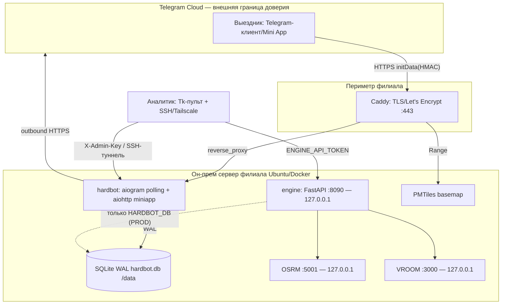

# 1+9. Архитектура системы, среды и сеть

## 1.1. Компоненты и стек

| Компонент | Технология | Роль | ПД? |
|---|---|---|---|
| **Бот** `hardbot/app.py` | Python 3.12, aiogram 3, long polling | UX выездника: свои клиенты → карточка → фиксация выезда | **Да** |
| **Миниапп (web)** `hardbot/web.py` | aiohttp (идёт с aiogram) | Telegram Mini App API + раздача статики/тайлов | **Да** |
| **Хранилище** `hardbot/db.py` | SQLite (WAL) | Реестр должников, визиты, привязки, метки, аудит | **Да** |
| **Скоринг** `hardbot/scoring.py` | чистый Python | Единый приоритет «куда выгоднее ехать» (бот+движок) | Да (на входе) |
| **Геокодер** `hardbot/geocode.py` + `gazetteer.py` | Python, OSM/GeoNames | Адрес → координата (слоями, офлайн-фолбэк) | Да (адрес) |
| **Пульт** `pult/pult.py` | Python 3.12, Tkinter | Десктоп аналитика: импорт/экспорт, веса, привязки | Да |
| **Движок** `engine/app/main.py` | FastAPI/uvicorn | Дашборд + аналитика/маршрут (демо — синтетика) | Только при `HARDBOT_DB` |
| **Маршрут** `engine/routing.py`,`planner.py` | Python + OSRM + VROOM | Объезд по дорогам, раздача на бригаду | Нет (координаты) |
| **Карта** | MapLibre GL + PMTiles (Caddy, Range) | Базовый слой + точки | Нет (тайлы) |

Старый встроенный `hardbot/gui.py`/`theme.py` исключён из прод-образа
(`.dockerignore`). Рабочий операторский интерфейс — отдельный `pult/pult.py`.

## 1.2. Среды (строго не путать)

| Среда | Где | Данные | Доступ |
|---|---|---|---|
| **DEV** | Windows-ПК владельца | Синтетика (`HARDBOT_DEV=1`, `synth.py`) | Локально |
| **STAGING / Демо** | VPS (`*.nip.io`), сервер движка `166.88.185.90` | **ТОЛЬКО синтетика. ПД НЕТ НИКОГДА** | SSH-ключ |
| **PROD** | Он-прем: ПК аналитика / мини-сервер в филиале | **Реальные ПД** (он-прем, не уезжают) | Физический + Tailscale |

> Жёсткое правило (зафиксировано в `engine/AGENTS.md`): на демо-серверах ПД не бывает;
> деплой несёт **только код**. Реальный реестр геокодится/обрабатывается **только** на ПК владельца.

## 1.3. Сетевая/деплой-диаграмма (PROD-филиал)

**Сетевые правила (контроли):**
- Движок, OSRM, VROOM слушают **только `127.0.0.1`**; наружу — только Caddy (TLS).
- БД-порт (если Postgres в будущем) — `127.0.0.1:5432`, не в LAN.
- Бот — исходящий long polling к Telegram (нет входящего вебхука → меньше поверхность атаки).
- Доступ администратора к филиалу — **Tailscale/Headscale** (работает за CGNAT), не публичный SSH.
- `restart: unless-stopped` — переживает отключение питания.

## 1.4. Ключевые архитектурные свойства для ИБ

- **Один процесс — одна БД (WAL):** бот и пульт делят SQLite; переживает аварийный ребут.
- **Минимум зависимостей:** стандартная библиотека + aiogram/aiohttp/openpyxl; меньше CVE-поверхность.
- **Данные пишутся пошагово** (каждый pick → запись), краш не теряет введённое.
- **Деплой несёт только код** (`.env`, `*.db` не выезжают — `.dockerignore`/`deploy` это гарантируют).
