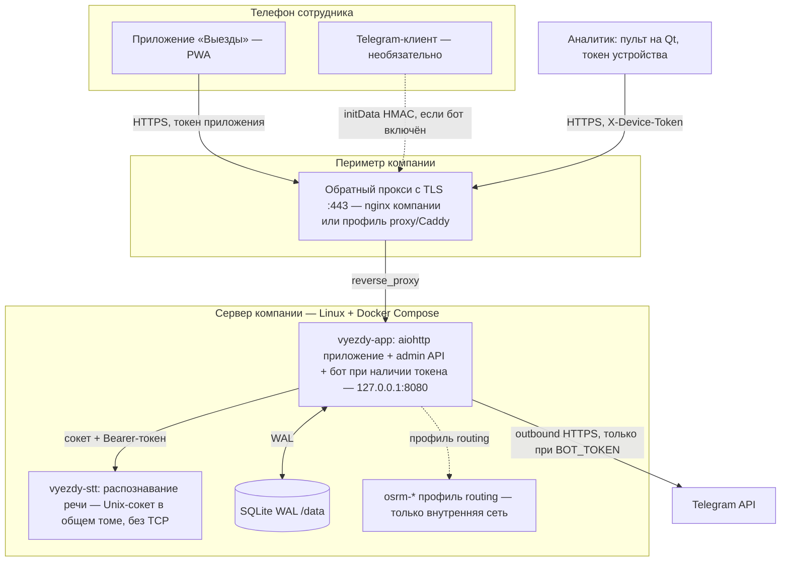

# 1+9. Архитектура системы, среды и сеть

> Обновлено 02.09.2026 под текущий состав пакета «Выезды»: сервер с приложением
> и необязательным Telegram-ботом, отдельный контейнер распознавания речи,
> настольный пульт на Qt, перенос реестров. Аналитический движок `engine/` в
> пакет ИТ не входит (демо на синтетике).

## 1.1. Компоненты и стек

| Компонент | Технология | Роль | ПД? |
|---|---|---|---|
| **Приложение сотрудника** `server/web.py` + `server/miniapp/` | aiohttp, PWA (работает офлайн, ставится на экран телефона) | Свои клиенты → карточка → фиксация выезда, фото, геопозиция, голос | **Да** |
| **Административный API** `server/web.py` (`/admin/*`) | aiohttp, мастер-ключ + токены устройств | Импорт/экспорт реестра, привязки, руководители, реестр доставленного, ссылки входа | **Да** |
| **Telegram-бот** `server/app.py` (необязателен) | aiogram 3, long polling | Сообщения выездникам и руководителям, сводки; при пустом `BOT_TOKEN` не запускается | Да |
| **Хранилище** `server/db.py` | SQLite (WAL), файл `hardbot.db` в `/data` | Реестр должников, визиты, привязки, метки, аудит, реестр доставленного | **Да** |
| **Служба речи** `stt/server.py` | faster-whisper, aiohttp на Unix-сокете | Голосовой комментарий → текст; наружу не слушает, доступ только по токену через общий том | Да (аудио транзитом, не хранится) |
| **Скоринг и геокодер** `server/scoring.py`, `geocode.py`, `geoindex.py` | чистый Python, офлайн-справочники GeoNames/OSM | Приоритет «куда ехать», адрес → координата без внешних сервисов | Да (адрес) |
| **Пульт** `pult/` | Python 3.12, PySide6 (Qt 6), Excel через xlwings | Настольная программа аналитика: импорт/экспорт, обогащение личных книг, привязки, руководители, устройства | Да |
| **Перенос реестров** `registry_cycle/` | Python, PySide6, Excel | Личные книги ↔ общий реестр с проверкой, планом, копиями и квитанциями | Да |
| **Маршрутизация** (профиль `routing`) | OSRM в контейнерах | Порядок объезда по дорогам; без него — упрощённый порядок | Нет (координаты) |
| **Карта** | MapLibre GL, PMTiles | Базовый слой и точки в приложении | Нет |

Единственный операторский интерфейс — `pult/` (точка входа `Пульт.pyw`, без
консоли). Устаревший встроенный Tk-пульт удалён.

## 1.2. Среды (строго не путать)

| Среда | Где | Данные | Доступ |
|---|---|---|---|
| **DEV** | ПК разработчика | Синтетика (`APP_DEV=1`, `synth.py`, `miniapp_dev.py`) | Локально |
| **Демо** | отдельный сервер движка | **ТОЛЬКО синтетика. ПД НЕТ НИКОГДА** | SSH-ключ |
| **PROD** | Linux-сервер компании с Docker (`deploy/`) | **Реальные ПД** (не покидают контур компании) | Обратный прокси с TLS; SSH только для ИТ |

> Жёсткое правило: на демо-серверах ПД не бывает; развёртывание несёт **только
> код**. Реальные реестры обрабатываются только на сервере компании и на ПК
> аналитика.

## 1.3. Сетевая/деплой-диаграмма (PROD)

**Сетевые правила (контроли):**
- Приложение слушает только `127.0.0.1:8080`; наружу — только обратный прокси с TLS.
- Служба речи не имеет TCP-порта: Unix-сокет в общем томе, у приложения он смонтирован
  только на чтение, доступ по токену из файла-секрета с правами 0640.
- OSRM (если включён) — только во внутренней сети compose.
- Telegram — исходящий long polling, входящего вебхука нет; при пустом `BOT_TOKEN`
  исходящих соединений к Telegram нет вообще.
- Пульт ходит токеном устройства; мастер-ключ нужен один раз для привязки устройства
  и для отзыва других устройств (`pult/УСТРОЙСТВА.md`).
- Вход сотрудника без Telegram: пульт выдаёт персональную ссылку, сервер заводит
  служебную личность из диапазона выше любого Telegram-id.
- `restart: unless-stopped` — стек поднимается после перезагрузки.

## 1.4. Ключевые архитектурные свойства для ИБ

- **Один процесс — одна БД (WAL):** приложение и бот в одном процессе; SQLite переживает
  аварийный ребут; резервная копия — онлайн-бэкап (`deploy/backup.sh`).
- **Минимум зависимостей:** стандартная библиотека + aiohttp/aiogram/openpyxl на сервере,
  faster-whisper в отдельном контейнере; меньше поверхность CVE.
- **Данные пишутся пошагово**, офлайн-очередь на телефоне досылается при связи.
- **Реестр доставленного:** обогащение личных книг сравнивает сервер, файл и то, что
  само записало в прошлый раз, поэтому правки офиса не затираются молча; конфликты
  показываются оператору и не пишутся.
- **Развёртывание несёт только код:** `.env`, базы, фото, модели речи не входят ни в
  образ, ни в пакет для ИТ (`tools/build_it_package.py` со сканером утечек).
