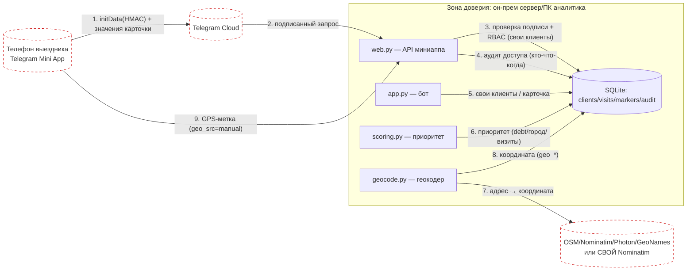

# 2. Диаграммы потоков данных (DFD) с границами доверия

Границы доверия (trust boundaries) — где ПД пересекают зону контроля. Главные ПД в пути:
**адрес/координаты должника** и **GPS-метка выездника**.

## 2.1. DFD уровня 1

## 2.2. Границы доверия и что на них происходит

| Граница | Что пересекает | Контроль |
|---|---|---|
| **Телефон ↔ Telegram** | значения карточки, GPS-метка | TLS Telegram; клиенту НЕ доверяем |
| **Telegram ↔ web.py** | `initData` (telegram_id, подпись) | **HMAC-SHA256 проверка** (`validate_init_data`), 24 ч свежесть, constant-time |
| **web.py ↔ БД** | чтение/запись карточки должника | **RBAC**: только `responsible==employee` или ADMIN; **аудит** каждого доступа |
| **geocode.py ↔ внешние геокодеры** | адрес должника (ПД!) | по умолчанию публичный OSM; для 152-ФЗ → **свой Nominatim/Photon** (env), адрес не уходит наружу |
| **Движок API ↔ клиент** | договор/город/долг/скор | **ENGINE_API_TOKEN**; реальная БД без токена не отдаётся |
| **Деплой ↔ сервер** | КОД (не ПД, не `.env`) | SSH-ключ; `.dockerignore` исключает БД/секреты |

## 2.3. Критичный момент — геокодинг адресов

Адрес должника — это ПД. По умолчанию `geocode.py` ходит в публичные OSM-сервисы
(Nominatim/Photon). **Для боевого режима под 152-ФЗ адреса не должны уходить наружу** →
базовые URL переключаются на свой инстанс одной env-переменной:
`NOMINATIM_URL` / `PHOTON_URL` / `LIBPOSTAL_URL`. Офлайн-фолбэк (GeoNames-центроид аула,
встроенный газеттир) работает **без сети вообще**.

> Контроль для ИБ: на PROD задать собственные `*_URL` (или работать офлайн-газеттиром),
> чтобы адреса должников не покидали периметр. Боевой реестр геокодится только на ПК владельца.

## 2.4. Поток GPS-метки выездника

`POST /api/marker` → проверка, что кейс «свой» → `db.add_marker` (таблица `markers`) →
точка человеку `geo_src='manual'` (ручную метку выездника НЕ перетираем автогеокодером).
Это самые свежие и достоверные координаты; помечены как доверенные.
