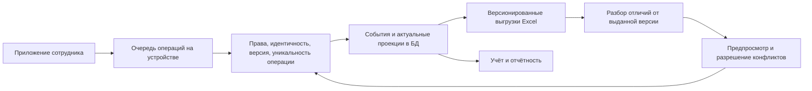

# Единый реестр и CRM: контракт данных и переход

Предложение от 03.11.2026. Это проект перехода, а не описание уже выпущенной CRM.
Основание: ревью текущего кода и фактических квитанций обмена. Рабочие данные и
персональные примеры находятся только в приватном каталоге операции.

Подтверждённые дефекты текущего обмена и границы исправлений перечислены в
[результате адверсарного ревью](pipeline-adversarial-review-2026-11-03.md).

## Решение

Единый формат реестра поддерживаем. Убираем зависимость структуры данных от
того, кто открыл карточку. Обязанности по звонкам, выездам и подтверждению оплат
сохраняем как полномочия и назначения. Один сотрудник может иметь несколько
полномочий. История содержит автора и вид действия, независимо от его роли сегодня.

Приложение хранит первичные события работы сотрудников. Excel остаётся необходимым
учётным документом, источником согласованных изменений портфеля и формой выгрузки.
Общий реестр собирается из проверенного состояния данных. Изменённый Excel проходит
импорт отличий относительно выданной версии. Обратный импорт прежней выгрузки
не создаёт новых звонков, выездов, оплат или изменений авторства.

## Карточка и ежедневная работа

Счётчики «Клиенты» и «Договоры» показываем раздельно, с единицей измерения.
Одна строка человека может содержать несколько договоров; суммы и охват
звонка нельзя неявно считать по числу строк Excel.

| Раздел | Содержимое | Основные действия |
|---|---|---|
| Обзор | Следующее действие, актуальные обещания, задолженность, ответственные, свежие события | Начать звонок, запланировать действие, открыть маршрут |
| Клиент и контакты | Проверенные и дополнительные телефоны, адреса, источник, дата проверки | Добавить сведения, предложить исправление |
| Договоры | Отдельная строка на договор, партнёр, долг, стадия, закрепления | Выбрать охват действия; посмотреть детали договора |
| История работы | Звонки, выезды, заметки, изменения, отмены и исправления | Добавить результат; исправить своё событие по правилам |
| Обещания и задачи | Сумма, валюта, срок, обещавший, сотрудник, фактическое выполнение | Зафиксировать обещание, перезвон, встречу |
| Оплаты и документы | Заявленные оплаты, чеки, подтверждённые поступления и связь между ними | Добавить чек; подтвердить сверку в пределах полномочий |

Рабочий стол: «Мои задачи», список клиентов, фильтры, поиск, просроченные обещания.
Не заставлять сотрудника обходить вкладки для сохранения звонка: компактная форма
результата рядом с контекстом клиента. Скрипт руководителя — сворачиваемая боковая
панель в режиме звонка; версия скрипта фиксируется при начале работы. Обновление
текста руководителем не меняет подсказку посреди звонка. Скрипт можно открыть
из карточки; он не заслоняет контакты и обещания.

Сохранение показывает три разных состояния: «Сохранено на устройстве»,
«Принято сервером», «Выгружено в реестр». Недоступность Excel не мешает принять
результат сотрудника. Ошибка доставки отображается аналитикам с причиной и
возможностью продолжить конкретную операцию. Сотруднику нельзя показывать
«Не доставлено», если его звонок уже принят сервером.

## Права

«Видна вся информация» означает всю карточку разрешённого клиента. Доступ к
чужим портфелям не расширяется автоматически при объединении вкладок.

| Действие | Сотрудник | Руководитель в своей области | Аналитик / уполномоченный учёт |
|---|---|---|---|
| Читать сведения разрешённого клиента | Да, все смысловые разделы | Да | По служебной области |
| Создать результат звонка / выезда | По выданному полномочию и назначению | По полномочию, с собственным авторством | Только по отдельному полномочию |
| Исправить результат | Новое исправление собственного события по политике | Исправление с причиной и аудитом | Импорт сверяемой корректировки |
| Изменить долг, партнёра, закрепление | Нет | Только при отдельно выданном праве | Через проверяемую операцию |
| Прикрепить чек / заявить оплату | Да | Да | Да |
| Подтвердить поступление денег | Нет по факту наличия чека | Только при учётном полномочии | Да, с источником подтверждения |
| Редактировать скрипт | Нет | В своей области | По отдельному праву |

Проверки выполняются сервером для чтения и записи каждого объекта. Скрытая кнопка
не является защитой. Передача портфеля не меняет авторство старых действий.
Руководитель, действующий вместо сотрудника, остаётся реальным автором; сохраняются
оба признака: кто действовал и в чьём рабочем контексте.

## Сущности и идентичность

* Клиент — устойчивый внутренний `person_id`. ФИО, адрес и телефон служат для
  поиска кандидатов на объединение; автоматическое слияние по ФИО запрещено.
* Договор — внутренний `contract_id` и внешняя пара `(creditor_id, external_id)`.
  Смена кредитора — отдельная операция с сохранением происхождения, а не
  перезапись поля по совпавшему номеру. Пока действует старый ключ, коллизия
  блокирует импорт с понятным перечнем строк.
* Назначение — сотрудник, обязанность, договор/клиент, начало и конец действия.
  Права, назначение и автор события — разные сущности.
* Событие — устойчивый ID, вид, автор, связанные договоры, время события,
  время приёма сервером, источник и ссылка на исправляемое событие.
* Обещание, задача, заявленная оплата, чек и подтверждённое поступление —
  отдельные сущности. Они связываются, но не подменяют друг друга.

При групповом звонке явно сохраняется набор затронутых договоров. Изменение
закреплений после звонка не расширяет этот набор задним числом. Перечисление
договоров в карточке и правила распространения записи должны использовать
один и тот же серверный алгоритм.

## Направления обмена

| Данные | Первичный источник | Что означает изменение Excel |
|---|---|---|
| Звонок, выезд, заметка | Принятое событие приложения | Предложение корректировки; никогда новый фиктивный факт |
| Долг и параметры портфеля | Согласованный учётный источник | Обновление по ключу договора и версии источника |
| Назначение | Уполномоченная операция | Явная смена/снятие; отсутствие строки само по себе недостаточно |
| Подтверждённая оплата | Учёт с идентификатором поступления | Сверяемое поступление или корректировка |
| Обещание/прогноз | Событие, породившее конкретное значение | Исправление с базовой версией и автором |
| Текущий комментарий | Представление событий за период | Совместимый текстовый экспорт, не единственное хранилище истории |

В общем результате нельзя безусловно предпочитать Хард Софту. «Обещает оплатить»,
«Нет контакта», полученный чек и подтверждённое погашение описывают разные факты.
Показываем их отдельно. Если нужен один сводный статус для отчёта, он вычисляется
по опубликованному правилу и содержит ссылки на основания.

## Формат Excel и правила импорта

Одна схема для всех сотрудников: смысловые блоки и стабильные ключи полей.
Профили могут различаться фильтром строк и видом, но не значением одинаковой
колонки. Служебные ключи и версии можно вынести в защищённый технический лист;
секреты туда не помещаются. Скрытие листа не считается защитой.

Первый совместимый шаблон сохраняет лист «Портфели», привычные формулы и
смысловые группы колонок. Убирается разделение шаблонов по должности, а поля
звонка и выезда остаются разными видами деятельности. Удалять старые столбцы
до проверенного сопоставления их данных нельзя.

Автор правки Excel не определяется по имени файла или указанному сотруднику.
Импорт подписывается вошедшим оператором; спорное изменение получает явное
утверждение уполномоченного лица. Защита ячеек помогает не ошибиться, но
проверка прав и допустимых полей остаётся на сервере.

Каждая выгрузка получает ID, период, версию схемы, область договоров, ревизии
строк/полей и квитанцию. Базовый снимок хранится сервером. Импорт сравнивает
три значения: что было выдано, что вернул Excel, что сейчас хранится в базе.

1. Excel равен базе выгрузки — пользователь не менял поле; новую БД не откатываем.
2. БД равна базе выгрузки — проверяем разрешённое изменение Excel.
3. Обе стороны изменились одинаково — подтверждаем совпадение без нового события.
4. Обе стороны изменились по-разному — показываем конфликт. Решение связано
   с точными значениями и ревизиями, при их изменении требуется новое решение.

Отсутствующая колонка, пустая ячейка, ноль и команда очистки различаются.
Пустая строка не снимает сотрудника. Полный импорт требует явного манифеста
полноты области; частичный импорт не удаляет отсутствующие записи. Сотрудники,
которые исчезли из файла целиком, обязательно попадают в отчёт сверки области.

Старые Excel без версии считаются непроверенными источниками. Дата файла,
совпадение статуса и календарный день не доказывают свежесть конкретного поля.
Для них нужен предпросмотр и ограниченная совместимость; конфликт нельзя
разрешать порядком файлов, положением строки или предпочтением роли.

Неизвестные колонки сохраняются при круговом переносе. Переименование требует
сопоставления; новая колонка получает зарегистрированное значение и тип.
Перестановка колонок не меняет смысл. Повтор ключевой колонки или неизвестная
версия схемы блокирует запись, а не угадывается. Формулы, VBA и оформление
за пределами разрешённых изменений проверяются после подготовки файла.

## Время, периоды и надёжность

Время события и время получения сервером хранятся отдельно; служебное время
фиксирует сервер. Календарный день определяется часовым поясом подразделения.
Офлайн-доставка старого события добавляет его в историю, не откатывая текущий
результат. Время приёма нельзя выдавать за время совершения работы.

При смене месяца история не очищается: меняется представление периода.
Поздняя оплата за октябрь относится к октябрю, даже если принята в ноябре.
Подтверждение закрытия периода и пересмотр отчёта — отдельные операции с аудитом.
На переходном этапе старые текстовые поля очищаются только по явному режиму,
с проверкой сохранённой истории и отдельным счётчиком защищённых записей.

Операция записи имеет устойчивый ID и привязанный состав данных. Повтор с тем
же ID возвращает квитанцию; другой состав с тем же ID — конфликт. Результат
неизвестного сетевого запроса сначала запрашивается, а не выполняется заново.
Доставка подтверждается для конкретной книги, строки, поля и версии результата.
«Записано в личную книгу» и «собрано в общий реестр» — разные подтверждения.

Перед разборкой проверяется полнота сборки. Ошибка хотя бы обязательного источника
останавливает зависимые шаги. Частичный прогон имеет явный список исключений и
не получает статус полного успеха. Перекрепление выполняется после сбора
результатов прежних назначений. Изменение исходника между планом и публикацией
аннулирует план. Пакет программы проверяет целостность всех своих компонентов.

## Учёт рабочего времени

Предложенные начало работы, перерыв, продолжение и завершение можно встроить
в то же рабочее место отдельным журналом событий. У сотрудника одна открытая
смена; сервер задаёт время подтверждённого перехода. Незавершённая смена
показывается явно, ночь и смена месяца не обрывают её автоматически.
Офлайн-запрос без подтверждённого серверного времени требует отдельного правила
сверки. Продолжительность звонков не подменяет отработанное время.
Отчёт руководителя строится из этого журнала после согласования правил учёта.

## Переход без остановки сотрудников

1. Закрыть обнаруженные ошибки и выпустить совместимые исправления; снять
   контрольный срез фактов, назначений, учётных записей и книг.
2. Ввести внутренние идентификаторы и таблицы соответствий без массового
   объединения людей. Коллизии вынести в отдельный проверяемый список.
3. Добавить журнал событий и версии там, где их ещё нет. Проверить построение
   текущих карточек из сохранённой истории, включая старые снимки.
4. Запустить единую схему Excel в режиме сравнения: старый и новый экспорт
   из одного среза, машинная сверка всех значимых полей, без двойной записи.
5. Пилот: одно подразделение, новый интерфейс и оба вида работы. Старые клиенты
   остаются совместимыми; для каждого поля действует только один маршрут записи.
6. После полного цикла «офлайн → сервер → личный Excel → общий → импорт» и
   перехода месяца расширить охват. Старые скрипты вывести из расписаний и
   заменить одним поддерживаемым входом с квитанциями.
7. Отчётность строить на этих же событиях и учётных данных следующим этапом.

Критерии приёмки: ни одного потерянного/придуманного события; совпадение всех
денежных значений и валют; неизменность авторства; отсутствие расширения прав;
проверенные конфликты и снятия; восстановление после потери сети/ответа/процесса;
сохранность формул; отсутствие повторных публикаций при восстановлении.
Обновление откатывается кодом; живую БД нельзя заменять вчерашним backup после
того, как сотрудники продолжили работу.
